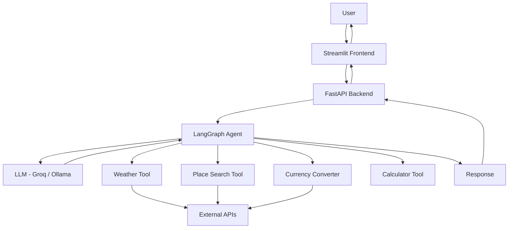

# 🧭 AI Trip Planner — Agentic Travel Planning Assistant

An AI-powered travel planning application that helps users plan trips through natural-language conversations. It generates travel itineraries, discovers attractions and restaurants, provides weather information, calculates estimated expenses, and supports follow-up questions through conversational memory.

Built with **Python, Streamlit, FastAPI, LangGraph, and LLMs**, this project explores how agentic AI can simplify travel planning by combining reasoning with external tools.

---

## 🚀 Features

- **AI-Powered Itinerary Generation:** Generate structured, day-by-day travel plans from natural-language queries.
- **Multiple Travel Options:** Explore mainstream and off-beat itinerary suggestions.
- **Attraction Discovery:** Find popular attractions and places to visit.
- **Restaurant Discovery:** Search for restaurants and eateries at your destination.
- **Weather Information:** Retrieve current weather and forecast information.
- **Expense Calculation:** Calculate estimated trip expenses and budgets.
- **Currency Conversion:** Convert expenses between currencies.
- **Conversational Memory:** Ask follow-up questions while maintaining the context of your ongoing trip.
- **Caching:** Reuse previously fetched external API results to reduce unnecessary API calls.
- **Performance Monitoring:** Track request duration, LLM execution time, tool execution time, agent invocations, and token usage.
- **Multiple LLM Providers:** Supports Groq and Ollama configurations.

## 🏗️ System Architecture

The application follows an agent-based architecture in which the frontend communicates with a FastAPI backend. The backend invokes a LangGraph agent that decides which tools are required to answer the user's query.



### Technology Stack

| Component | Technology |
|---|---|
| Programming Language | Python |
| Frontend | Streamlit |
| Backend | FastAPI |
| Agent Framework | LangGraph |
| LLM Integration | LangChain |
| LLM Providers | Groq, Ollama |
| HTTP Client | HTTPX |
| Caching | cachetools |
| Place Discovery | Google Places, Tavily |
| Weather Data | OpenWeatherMap |
| Currency Conversion | ExchangeRate API |
| Version Control | Git, GitHub |
| AI-Assisted Development | Kiro |

## 🧠 Agent Tools

The LangGraph agent has access to specialized tools:

| Tool | Responsibility |
|---|---|
| WeatherInfoTool | Retrieves weather information and forecasts |
| PlaceSearchTool | Searches attractions, restaurants, activities, and transportation |
| CalculatorTool | Performs travel expense and budget calculations |
| CurrencyConverterTool | Converts amounts between currencies |

The agent determines which tools to invoke based on the user's query.

## ⚡ Performance Optimization

Performance optimization is an important part of this project.

The optimization work focuses on reducing unnecessary external API calls, improving asynchronous execution, and monitoring agent performance.

Implemented optimizations include:

1. **Asynchronous LLM Execution:** Uses asynchronous invocation for agent LLM calls.
2. **Asynchronous HTTP Requests:** Uses HTTPX AsyncClient for weather and currency API requests.
3. **Reusable Search Instances:** Reuses the Tavily search instance instead of creating a new instance for every search.
4. **TTL-Based Caching:**
   - Place search results: 1 hour.
   - Current weather: 10 minutes.
   - Weather forecasts: 30 minutes.
   - Currency exchange rates: 1 hour.
5. **Request-Level Instrumentation:** Tracks request duration, agent invocations, LLM call durations, tool execution times, and token usage.

> Performance measurements are being evaluated against a baseline. Actual latency depends on LLM provider response times, rate limits, external APIs, and conversation context.

## 🛠️ Getting Started

### Prerequisites

- Python 3.11+
- Git
- `uv` package manager
- API credentials for the external services you intend to use
- Groq API access or a locally running Ollama installation

### 1. Clone the Repository

```bash
git clone https://github.com/somshivgupta/AI_Trip_Planner.git

cd AI_Trip_Planner
```

### 2. Set Up the Environment

```bash
uv sync
```

Activate the virtual environment if you prefer working directly inside it.

### 3. Configure Environment Variables

Create a `.env` file in the project root.

Add the API keys required by your configuration:

```env
GROQ_API_KEY=your_groq_api_key
GPLACES_API_KEY=your_google_places_api_key
TAVILY_API_KEY=your_tavily_api_key
EXCHANGE_RATE_API_KEY=your_exchange_rate_api_key
OPENWEATHERMAP_API_KEY=your_openweathermap_api_key
```

Use the exact environment variable names expected by your configuration files. Do not commit your `.env` file or expose API credentials.

### 4. Start the FastAPI Backend

Run the FastAPI application using its actual Python module:

```bash
uv run --active uvicorn <fastapi_module>:app --reload --port 8000
```

Replace `<fastapi_module>` with the module containing your FastAPI application.

The backend will be available at:

```text
http://localhost:8000
```

### 5. Start the Streamlit Frontend

Open another terminal:

```bash
uv run --active streamlit run app.py
```

Open the local Streamlit URL displayed in the terminal, usually:

```text
http://localhost:8501
```

## 💬 Example Queries

Try asking the travel assistant:

```text
Plan a 5-day trip to Goa.

Plan a 7-day trip to Manali with a moderate budget.

Plan a 5-day trip to Bangkok.

What is the estimated budget for the first three days?

Suggest some off-beat attractions.

What is the weather forecast for my destination?
```

The assistant can handle follow-up questions using the conversation context associated with the current chat thread.

## 🧩 Kiro Integration

Kiro is used as an AI-powered development environment to support structured and specification-driven development.

Instead of relying only on ad-hoc code changes, the project uses Kiro steering files and specifications to document project requirements, architecture, and implementation tasks.

### Kiro Steering

The project maintains steering files under:

```text
.kiro/
└── steering/
    ├── product.md
    ├── tech.md
    └── structure.md
```

These files provide Kiro with persistent project context:

- `product.md`: Project purpose, features, and product expectations.
- `tech.md`: Technology stack, architecture, and implementation conventions.
- `structure.md`: Project structure and code organization.

### Spec-Driven Development

The performance optimization work is organized as a Kiro specification:

```text
.kiro/
└── specs/
    └── performance-optimization/
        ├── requirements.md
        ├── design.md
        └── tasks.md
```

The specification defines the optimization requirements, technical design, and implementation tasks.

This approach helps keep development organized, makes implementation decisions traceable, and provides a clear way to validate changes.

## 📁 Project Structure

```text
AI_Trip_Planner/
│
├── .kiro/
│   ├── steering/
│   │   ├── product.md
│   │   ├── tech.md
│   │   └── structure.md
│   │
│   └── specs/
│       └── performance-optimization/
│           ├── requirements.md
│           ├── design.md
│           └── tasks.md
│
├── agent/
│   └── agentic_workflow.py
│
├── tools/
│   ├── weather_info_tool.py
│   ├── place_search.py
│   ├── currency_conversion_tool.py
│   └── calculator_tool.py
│
├── utils/
│   ├── weather_info.py
│   ├── place_info_search.py
│   ├── currency_converter.py
│   └── timing.py
│
├── app.py
├── baseline_results.md
├── pyproject.toml
├── uv.lock
└── README.md
```

*The structure above highlights the main project components; adjust it to match the actual repository.*

## 🔒 Security

- Store API keys in environment variables.
- Keep `.env` out of version control.
- Never expose API credentials in logs or public documentation.
- Validate and verify generated travel information before making bookings.

## 📄 License

This project is open source. See the `LICENSE` file for the applicable license.